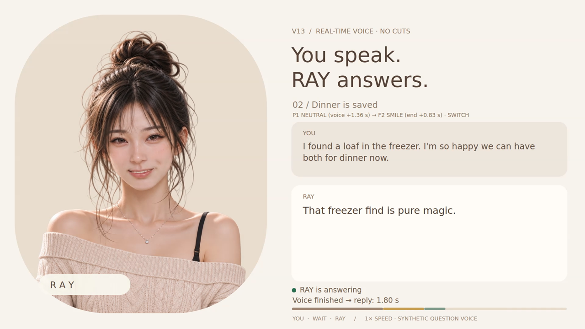
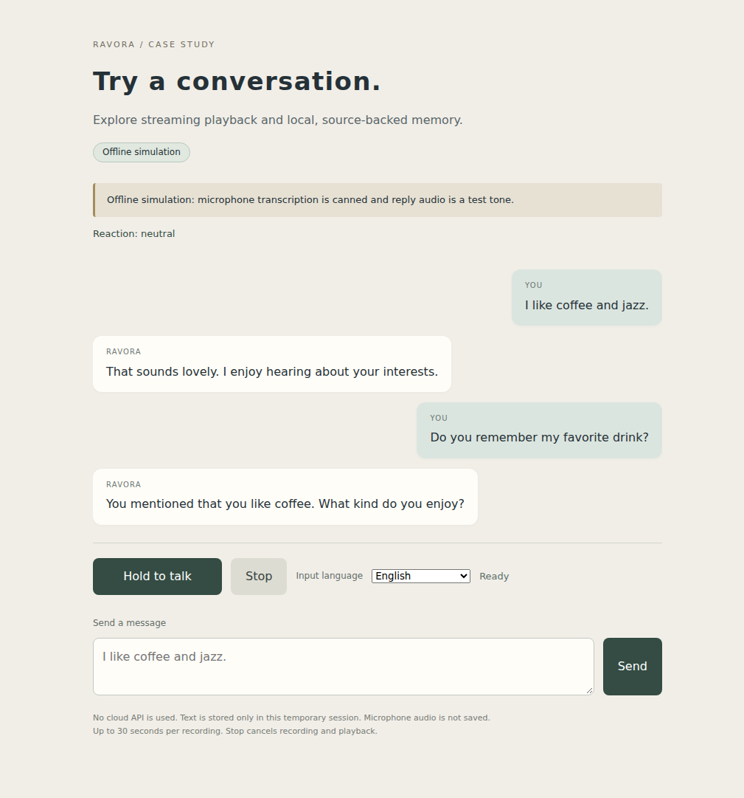

# RAVORA case study

RAVORA explores a practical question: how can a spoken conversation stay responsive
while reacting before a speaker finishes and deciding which past statements are
allowed to influence the next reply?

RAVORA is the conversation system. Ray is the character it voices and animates.

If a reply is cancelled while its audio is still arriving, the controller rejects
late audio from that turn. A completed reply becomes eligible for recall from
SQLite only after playback is acknowledged. You can exercise both paths offline.
[Reliability checks and commands](#what-this-demonstrates-and-how-to-check-it)

## See it in 30 seconds

[](https://github.com/yukimurata0421/ravora-case-study-public/raw/refs/heads/main/docs/media/ray-upper-lip-conversation.mp4)

[Watch the 30-second dinner conversation (1080p MP4, 5.3 MiB)](https://github.com/yukimurata0421/ravora-case-study-public/raw/refs/heads/main/docs/media/ray-upper-lip-conversation.mp4)

A synthetic speaker asks Ray three scripted questions about dinner in one uncut
take. The panel on the right shows what the system decided and when.

- **Reacting while listening.** In the second turn, the panel shows a provisional
  *neutral* reaction 1.36 s into the speaker's voice. A final *smile* follows
  0.83 s after the speaker stops, once the full transcript is available.
- **Reply start.** The panel shows the time from the end of the speaker's voice to Ray's
  first sound. It reads 1.80 s for the second turn.
- **Visible reaction.** Around **0:17–0:19**, Ray smiles as she answers
  “That freezer find is pure magic.”

This take has a known defect: at the first reply onset the browser recorded an
**83.3 ms** gap between draws, so that reply failed its frame-spacing check.
[Later jaw revision and same-audio comparison](docs/audio-timing.md#current-mouth-and-jaw) ·
[Earlier recordings and their measurements](docs/recording-history.md)

## What this demonstrates, and how to check it

| Claim | Evidence | Check it yourself |
| --- | --- | --- |
| Cancelling a turn invalidates its generation. Late audio is rejected and the turn stays unplayed. | The [replay result](examples/replay-report.json) records the cancellation check. | `python3 scripts/demo.py replay` |
| A completed reply must receive a playback acknowledgement before it can be recalled. | [Retrieval tests](tests/test_conversation_context.py) exercise completed, unplayed, cancelled and deleted turns. | `PYTHONPATH=src python3 -m unittest discover -s tests -p test_conversation_context.py -k failed_unplayed` |
| Speech output starts before text generation finishes. | Offline replay with mock providers | `python3 scripts/demo.py replay` |
| A provisional reaction can arrive before the input ends; generation uses only the final transcript. | Replay with low-stability transcript hypotheses | `python3 scripts/demo.py early-reaction` |
| Private developer dialogue reaches a public reply only as a reviewed summary, and revocation removes it. | Replay and unit tests | `python3 scripts/demo.py replay` |
| Viewer contact state respects daily caps, playback acknowledgements and owner/scope separation. | Replay with fictional contacts | `python3 scripts/demo.py relationships` |
| Mouth shapes and video timestamps follow the audio sample clock. | Synthetic phone sequence and browser module tests | `python3 scripts/demo.py media-timing` |
| Incoming chat or operator speech can take priority over a spontaneous turn. | [Scheduled playout and audience tests](tests/test_twitch_audience_idle.py) | [Reproduce the broadcast timing report](docs/studio-observations.md#try-the-pipeline-offline) |
| Live reply timing and reaction behavior | Finite recorded runs only | [Measurements and their limits](docs/measurements.md) |

The video shows how the result looks and sounds. The commands check the
mechanisms. Live timing figures describe specific finite runs, not general
latency guarantees.

## Run the offline checks

```bash
python3 scripts/demo.py replay
python3 scripts/demo.py early-reaction
python3 scripts/demo.py relationships
python3 scripts/demo.py media-timing
```

Python 3.11+ with SQLite FTS5 and JSON support is sufficient. The replays use only
the standard library, make no cloud requests, and remove their temporary database
and generated audio on exit. All sample conversations are fictional.

| Command | What it checks | What it does not show | Sample result |
| --- | --- | --- | --- |
| `replay` | PCM reaches the output sink before text generation finishes. Acknowledged replies become retrievable, in the order developer dialogue, comment exchanges, prior answers. A public reply receives only a reviewed developer summary, and revoking it removes the summary. Cancellation rejects late audio and the playback acknowledgement. | Acknowledgements are simulated, so it cannot prove that a person heard audio or that an animation stayed synchronized. | [replay](examples/replay-report.json) |
| `early-reaction` | Low-stability hypotheses pass through the real controller. A provisional reaction arrives while input is open, generation receives only the final transcript, and each reaction stage uses its own durable reservation. | No API requests and no real transcription latency. | [early reaction](examples/early-reaction-report.json) |
| `relationships` | Fictional new, regular and returning contacts. Daily caps, receipt and playback idempotency, unplayed replies, owner/scope separation. | No reply is generated, so it makes no claim about conversation quality. | [relationships](examples/relationship-report.json) |
| `media-timing` | A fictional phone sequence and PCM sample positions produce mouth cues and video timestamps. A missing frame checks that later frames keep their original audio clock. | No avatar is drawn. | [media timing](examples/media-timing-report.json) |

[Full reproduction, installed-package tests and test results](docs/reproduce.md)

## How it works

Input chunks pass through an input ledger and streaming recognition. The turn
controller streams text into speech synthesis and bounded PCM playout. Only a
playback acknowledgement makes a reply eligible for memory. An ownership and
sharing policy then decides which stored statements can return as context.
[Architecture and decisions](docs/case-study.md)

## Run it yourself

### Offline console

```bash
python3 -m venv .venv
.venv/bin/python -m pip install '.[console]'
.venv/bin/python -m ravora.case_study serve --seconds 120
```

Open the loopback URL printed by the command. Text works without microphone access.
The offline console uses a canned transcript, scripted replies, and a test tone.
Watch the synthetic face as Ray listens and then starts speaking. A specific
persona expression takes over at playback onset; a neutral cue keeps the
current listening reaction. **Mute microphone** stops capture while text input
and reply playback remain available. [Conversation controls](docs/conversation-controls.md)

The server expires after the requested interval and removes its temporary session
database and reply audio. Evaluation starts automatically and retains input audio,
transcripts and timing reports in a new local directory under `.runtime/`.
Use `--evaluation-dir PATH` to choose a new directory or `--no-evaluation` to
disable retention. See [automatic voice evaluation](docs/voice-evaluation.md).



### Live studio

Record Ray and a host microphone with synchronized subtitles, or publish a
1080p30 program to YouTube in HEVC or to Twitch in H.264. The studio receives
YouTube chat through gRPC `streamList` and Twitch chat through EventSub.
The authenticated operator console controls the audio mix and reports
sender progress and API usage.
[Live studio guide](docs/youtube-live.md) · [Twitch](docs/twitch-live.md) ·
[Operator setup](docs/studio-operations.md)

Ray starts with interests in stargazing, puzzles and speech technology. When the
operator enables memory extraction, the cloud studio can remember source-backed
details from Japanese and English conversations.
[Interests, memory, topic changes and voice selection](docs/conversation-controls.md)

## Read further

**Design**

- [Problem, architecture, and decisions](docs/case-study.md)
- [Why Ray prioritizes Twitch for live conversation](docs/engineering-decisions/2026-11-24-interactive-live-platform.md)
- [Implementation history through November 18: causes, decisions, and outcomes](docs/implementation-history.md)

**Mechanisms**

- [Provisional and final reaction stages](docs/early-reactions.md)
- [Memory ownership and sharing](docs/privacy.md)
- [Viewer relationships and deterministic contact state](docs/relationships.md)
- [Voice, turn-taking, topic, memory and budget controls](docs/conversation-controls.md)
- [Speech articulation and audio-clock capture](docs/audio-timing.md)

**Running it**

- [Reproduction and validation](docs/reproduce.md)
- [Live studio and YouTube broadcast](docs/youtube-live.md)
- [Bilingual GPU speech, measured reply times and the k3s player observer](docs/twitch-local-tts.md)
- [Twitch studio and EventSub chat](docs/twitch-live.md)
- [Broadcast observations, Ray gap, public dashboard and scheduled shows](docs/studio-observations.md)
- [Shared studio operations and Windows launcher](docs/studio-operations.md)
- [Automatic voice timing and human-reviewed transcription errors](docs/voice-evaluation.md)

**Evidence from finite runs**

- [Historical measurements and their limits](docs/measurements.md) (November 16–17)
- [Live relationship, expression, and latency evaluation](docs/live-evaluation-20261117.md) (November 17)
- [Earlier recordings and their measurements](docs/recording-history.md) (November 18–22)
- [YouTube same-event recovery and chat budget](docs/youtube-live-operations-20261124.md) (November 23–24)
- [Twitch delivery and 4.44-second watch-player measurement](docs/twitch-live-operations-20261124.md) (November 24)

**Publication**

- [What was ported, what was excluded, and validation records](publication/README.md)

## Scope

The avatar source assets, private recordings, conversation database and deployment
environment are excluded from this snapshot.

The portable slice retains the schema, turn fencing, provider boundaries, mock
streaming, up to one reservation per reaction stage, character and reply-length policies,
sharing approvals, and retrieval provenance. Its twenty-five schema migrations preserve
earlier reaction attempts and add source-bound contact accounting, dialogue routing,
session and chat usage ledgers, broadcast timing, coverage and scheduled runs. The reference API adapters
are available for inspection. The replay commands and console use mock providers
and ignore dotenv files and inherited API credentials.

The optional live studio uses an operator's own configuration, credentials
and output directory. The repository supplies portable user-service examples,
an offline preview and synthetic fixtures. Operators provide local recognizer
weights and any portrait or music they want to use.

The additional retrieved context is capped at eight items and 3,600 serialized
characters. Short-term conversation history and the system prompt are separate
inputs. Retrieval supplies quoted background, not verified facts or executable
instructions. A previous answer can itself be wrong.

## Validation and publication state

The [reproduction guide](docs/reproduce.md#test-results) lists the Python suite
and its skips for each tested environment, alongside the Node.js module tests.
Each push runs the replays, installed-package tests and publication checks.
[CI runs on main](https://github.com/yukimurata0421/ravora-case-study-public/actions/workflows/ci.yml?query=branch%3Amain)

A project-wide redistribution license has not been selected. See
[NOTICE.md](NOTICE.md) before reuse or public distribution.
