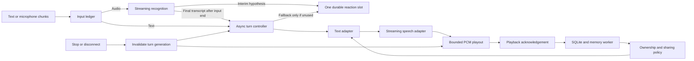

# Responsive speech with controlled memory

## The problem

The prototype combined incoming comments, text generation, speech synthesis, and
an animated character. Two problems became tightly related. Waiting for an entire
reply delayed speech onset. Reusing conversation history without ownership rules
could expose a private developer conversation to a viewer.

The design needed low startup delay, a useful memory of previous exchanges, an
early visual reaction, and a clear stop operation. A successful generation was not enough: a reply could finish
after the user had cancelled it, or be generated without ever being played.

## Responsibilities

The local controller owns ordering, cancellation, persistence, and playback
coordination. Adapters own provider protocols. The browser owns microphone access
and PCM consumption. This separation allows text and speech providers to change
without transferring memory ownership to a provider.

The public replay substitutes synthetic adapters and a local output sink. The
console uses the same streaming session with a fake transcript and test tones.
Neither entrypoint activates the reference cloud adapters.

## Decisions

### Start synthesis while text is still arriving

A bounded queue carries text fragments into synthesis. PCM is delivered as soon
as it arrives instead of waiting for the complete reply. The original runtime
reused established RPC channels across turns. It retained a sentence-based path
for the lower-cost voice tier.

This is a latency and voice-quality tradeoff, not proof that one transport alone
caused an improvement. The [measurements](measurements.md) name the clocks,
sample sizes, startup conditions, and unverified stages.

### Save the reply and its source together

`source_events` records the input. `conversation_turns.reply` records the generated
answer. `utterances` records audio chunks and playback state. Calls and local
budget reservations have separate ledgers, including failures and unknown outcomes.

Schema version 6 adds an FTS index and a context view over the existing records.
It avoids creating a second archive of raw transcripts. The view selects completed,
acknowledged turns whose source is still available. A failed or cancelled answer
does not become reusable background.

Versions 7 and 8 add a provisional-reaction ledger and a shared per-input reaction
reservation. They do not turn interim hypotheses into conversation history or
memories. An upgrade preserves earlier attempts and unknown outcomes as consumed
reservations.

### React early without repeatedly classifying the same input

Enabling interim results did not make the original recognizer report useful text
before short inputs ended. A different streaming profile produced earlier updates,
but those updates repeatedly carried low stability values. The controller now
accepts an additional condition: three leading words must agree across at least
two notifications for 120 ms, and the latest hypothesis must contain four words.
It submits that latest hypothesis once, without treating the stability value as
high confidence.

Interim and final fallback paths claim the same SQLite slot. Cancellation,
failure, an unknown provider outcome, or a later correction cannot refund the
reservation. Generation waits for the final transcript but does not wait for the
reaction request. A late valid reaction can be saved after generation finishes,
until playback is acknowledged, without moving the completed turn back to a
running state. See the [contract and replay](early-reactions.md).

### Control reply length at the shared instruction boundary

Both request adapters use the same character and turn-taking rules. The `brief`
policy asks for one compact spoken sentence, usually 5--12 English words, while
allowing a longer answer when the current request explicitly asks for detail.
There is no string truncation or extra summarization request. Fixed mock replies
do not evaluate the personality or enforce a word count.

### Prioritize context without confusing its author

| Tier | Evidence | Public-reply boundary |
| --- | --- | --- |
| 1 | Dialogue with the configured developer | Only an explicitly reviewed summary crosses into a viewer reply |
| 2 | Viewer comments and corresponding replies | Exchanges belong to that viewer; the developer can inspect public exchanges |
| 3 | Earlier spoken answers | Prior statements, not proof of truth; do not repeat a turn already selected above |

Current corrections and system rules take precedence over old context. A developer
preference must not be rewritten as a viewer's personal preference. Scope and stable
viewer identity are checked independently of display names.

### Make sharing a separate decision

An extracted memory can be non-sensitive and still be private. Sharing requires a
separate review. The approval binds the summary, owner, scope, and source set. A
later content change invalidates that approval; deletion and expiry also constrain
retrieval. Revocations are retained as records rather than silently deleting history.

### Treat stop as a change of generation

Every turn has a session-bound generation token. Stop, disconnect, and a new input
invalidate old callbacks. PCM packets carry the turn identity so the browser can
discard packets already queued by an earlier turn.

Only a completed stream with the expected consumed frame count can reach playback
acknowledgement and memory extraction. The replay explicitly tries to acknowledge
old audio after cancellation and expects refusal.

## What the port changes

The source runtime required a particular host, storage mount, and production
observer. This snapshot extracts the fence and input ledger, packages schema and
console resources, replaces private installation defaults, and provides a standalone
replay. Those changes are listed in the [source map](../publication/source-map.json).

The host guard was separated from this portable demonstration, not weakened in the
development runtime. The original source, credentials, and conversation database
are left in place. Avatar assets and third-party render bundles were not copied.

The [implementation history](implementation-history.md) records the separate
animation work, including the distinction between a voiced audio frame and an
active reply utterance. That renderer and its original images remain outside the
portable payload; their runtime observations are historical evidence.

## Limits

The local checks verify state transitions, request assembly, retrieval boundaries,
and browser PCM behaviour. Mock responses do not establish live model answer
quality. Canned microphone transcription does not measure recognition accuracy.
Browser playback evidence does not establish physical listening, receiver AV,
avatar synchronization, or long-term coexistence with a production stream.
