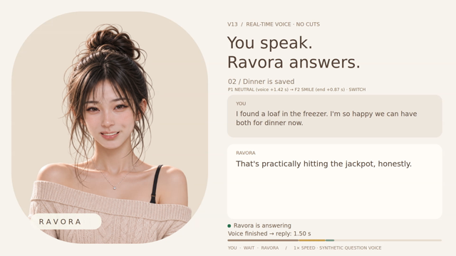

# Recording history

These dated recordings document how speech timing, expressions and mouth motion
changed during development. They show superseded motion and are kept for their
measurements. The [current design](audio-timing.md) and the
[README conversation](../README.md#see-it-in-30-seconds) describe the present state.

Recordings that no longer appear in the main pages are removed from the working
tree. Each link below points to the file as published in commit `9af86c6`, so
the measurements can still be compared with the original video. All figures
describe the listed finite takes only.

| First published (JST) | Recording | Shows | Video |
| --- | --- | --- | --- |
| 2026-11-22 | Reference render, 19 s, 720p | Jaw following the facial midline | [MP4](https://github.com/yukimurata0421/ravora-case-study-public/raw/9af86c66154f0ac265266cc7965d5cc82fdfe0cd/docs/media/ray-avatar-fixed-demo.mp4) |
| 2026-11-21 | Dinner conversation, 29.6 s | Conversational smile; the [README video](../README.md#see-it-in-30-seconds) | [MP4](media/ray-upper-lip-conversation.mp4) |
| 2026-11-21 | Upper-lip close-up, 2.5 s | Same line before and after | [MP4](https://github.com/yukimurata0421/ravora-case-study-public/raw/9af86c66154f0ac265266cc7965d5cc82fdfe0cd/docs/media/ray-upper-lip-comparison.mp4) |
| 2026-11-20 | Dinner conversation, 34.8 s | Zephyr voice, midline jaw | [MP4](https://github.com/yukimurata0421/ravora-case-study-public/raw/9af86c66154f0ac265266cc7965d5cc82fdfe0cd/docs/media/concept02-lip-motion.mp4) · [comparison](https://github.com/yukimurata0421/ravora-case-study-public/raw/9af86c66154f0ac265266cc7965d5cc82fdfe0cd/docs/media/concept02-lip-comparison.mp4) |
| 2026-11-20 | Dinner conversation, 30.8 s | Shared preview and live jaw motion | [MP4](https://github.com/yukimurata0421/ravora-case-study-public/raw/9af86c66154f0ac265266cc7965d5cc82fdfe0cd/docs/media/concept02-default-motion.mp4) · [comparison](https://github.com/yukimurata0421/ravora-case-study-public/raw/9af86c66154f0ac265266cc7965d5cc82fdfe0cd/docs/media/concept02-mouth-comparison.mp4) |
| 2026-11-19 | Dinner conversation, 34.3 s | Thinking reaction before the speaker finishes | [MP4](https://github.com/yukimurata0421/ravora-case-study-public/raw/9af86c66154f0ac265266cc7965d5cc82fdfe0cd/docs/media/ravora-thinking-conversation.mp4) |
| 2026-11-18 | Five-question live run | Frame spacing and audio/picture alignment | Not published |
| 2026-11-18 | Balcony conversation, 49.3 s | Audio-first reply start and word-aligned mouth | [MP4](https://github.com/yukimurata0421/ravora-case-study-public/raw/9af86c66154f0ac265266cc7965d5cc82fdfe0cd/docs/media/balcony-tomato-conversation.mp4) |

## November 21 conversational smile

The 29.568-second reference recording includes three scripted questions and
Ray’s spoken replies. The smile is visible in the second reply around 17–19 s.
At the first reply onset, the browser recorded an 83.3 ms gap between draws
and the recording failed its frame-spacing check. The largest onset gaps for
the second and third replies were 33.4 and 33.5 ms. The exported 30 fps file
includes the held frames.
[Validation record](../publication/history/2026-11-21-upper-lip-validation.json)

## November 20 lip and jaw revision

The 34.83-second 1080p dinner recording contains a synthetic input speaker and
three Zephyr replies. The development browser measured 2.62, 1.77 and 2.61
seconds from input end to reply audio in those turns. The three-way smile
comparison reuses a line to show the change in mouth shape. The published
surface and articulation logic matched the recording's source hashes after
adapting the module import for the portable package. These observations cover
the recorded turns; Windows speaker latency and long-term conversation quality
remain unmeasured.

## Concept 02 default motion

A stressed vowel used to make the mouth jump open on a single frame. This
revision averaged jaw samples up to 100 ms on either side of the playhead and
gave more weight to a narrower 50 ms window as the lips approached contact. On
the same smiling line the largest change in normalized opening between
consecutive frames fell from 0.31 to 0.22.

The three questions in the full recording were synthesized and played at normal
speed. Times are relative to the recording start on the browser audio clock.
Each gap runs from the last question signal to the first reply signal.

| Question | Question ends | Reply starts | Gap | Partial to final expression |
| --- | ---: | ---: | ---: | --- |
| Bread or soup? | 6.89 s | 8.78 s | 1.89 s | Neutral to thinking |
| A loaf in the freezer | 15.89 s | 17.39 s | 1.50 s | Neutral to smile |
| Lemon or yogurt? | 25.63 s | 27.27 s | 1.63 s | Thinking held |

The 1080p MP4 contains 924 frames over 30.83 s (29.97 fps). The source missed
one 30 fps tick. The encoder dropped zero queued frames. The decoded soundtrack
matches the captured question and reply audio across all three turns.

## The dinner conversation

Three English questions about dinner were synthesized in advance and streamed at
normal speed. Recognition, both reaction stages, reply generation and reply
synthesis used live APIs. The MP4 includes both voices and the wait between them.

| Turn | Speaker in the MP4 | Avatar in the MP4 | Silent gap | Partial → final |
| --- | --- | --- | --- | --- |
| Bread or soup? | 0.10–6.90 s | 8.90–11.69 s | 2.00 s | Neutral → thinking |
| A loaf in the freezer | 12.57–16.54 s | 18.50–21.28 s | 1.96 s | Neutral → smile |
| Lemon or yogurt? | 22.31–27.35 s | 28.93–32.87 s | 1.58 s | Thinking → thinking |

The audible boundaries come from decoded AAC in 10 ms windows at −48 dBFS.
The on-screen speaking indicator followed the first audible reply by 33–37 ms.
The source captured 1,029 frames. The 30 fps export held one frame for a
missing tick, giving 1,030 frames over 34.33 seconds. The figures describe
these three synthetic-speaker turns.
[Transcripts, scores and audio measurements](../publication/thinking-conversation-timings.json)

In the third turn the thinking pose first crossed a 0.05 render weight at
23.93 s, about 3.42 s before the speaker finished. The final decision retained
the pose, and the avatar kept that look as the reply started at 28.93 s.

## Historical recording, 2026-11-18 JST

The finite live run used five synthetic English questions and actual API replies.
It used one provisional and one final classification per input. Among the observed
transitions were a smile that persisted, a smile that changed to surprise, and a
smile that changed to concern.

| Check | Observation |
| --- | --- |
| Original capture | 29.718 fps. The 95th-percentile gap was 33.3 ms and the largest gap was 100 ms. The earlier capture had a largest gap of 167.8 ms. |
| Export | 1920 × 1080, fixed 30 fps. Nineteen missing source ticks used a held frame. |
| Encoded audio and picture | The audible reply and its on-screen speaking indicator were at most 53.3 ms apart. No playback underflow was observed. |
| Articulation | Alignment was ready at reply onset in four of five replies. One used the waveform fallback. Ten sampled lip closures were at or below 0.12 opening. |
| Waiting time | 2.64–3.28 s from question audio ending to reply audio starting. The recording profile allowed a bounded wait for the mouth plan. |

One earlier attempt played the replies but timed out during media retrieval.
Another preserved the media and exposed late phone alignment and uneven frame
spacing. The selected take used bounded binary uploads during recording. The
comparison concerns these finite samples. Codec timing and the speaking
indicator do not measure the perceptual correctness of individual mouth shapes,
human microphone latency, or long-running capture performance.

[Aggregated measurements](../publication/audio-timing-evaluation-20261118.json) ·
[Reproduction](reproduce.md)

## Reply timing in the balcony conversation

A synthetic speaker tells the avatar about the first ripe tomato on their
balcony. The opening line is fixed. For the next three turns, the partner waits
for the reply to finish and uses the exchange so far to decide what to say next.
Both voices, the speech-recognition captions, and the pauses are captured in one
take.

The partner opens with the same line in all three recordings. I decoded the
audio from each MP4 and measured from the end of the partner's voice to the
first audible reply. The uncut recordings include recognition, reply generation,
synthesis, and playback.

| Recording | Turn 1 | Turn 2 | Turn 3 | Turn 4 | Mean |
| --- | ---: | ---: | ---: | ---: | ---: |
| Original demo | 5.02 s | 4.17 s | 4.85 s | 3.89 s | 4.48 s |
| First audio-first demo | 2.44 s | 2.16 s | 1.77 s | 2.43 s | 2.20 s |
| Published demo | 2.30 s | 1.96 s | 2.20 s | 2.06 s | **2.13 s** |

In the published demo the word-aligned mouth shapes take over on *weeks* at
8.93 s, *totally* at 21.96 s, *eating* at 34.12 s and *sounds* at 45.99 s.
On each transition the lips start with the opening already visible.
The audio worklet reported zero underflows across all four replies.
[Close-ups of all four transitions](images/balcony-tomato-mouth.png).

A development take had 100 ms and 133 ms frame intervals during the first
reply. Encoding after the conversation reduced the longest interval to 67 ms
over the full 49.3-second take. From 100 ms before each audible reply through
its first second, the longest intervals were 67, 33, 33 and 33 ms respectively.
The two 67 ms intervals left in the full video each span one missing 30 fps tick.
In the published MP4, all 1,477 frame timestamps matched the live draws.
Seven 480 x 270 comparisons, four during speech and three at rest, also
matched pixel for pixel between the live canvas and the canvas before
compression. These pixel comparisons cover the seven sampled frames.

### Earlier audio-first measurements

The browser also recorded when it received the first PCM packet and when the
audio worklet consumed the first sample. Those events were an average of 1.61 s
apart in the original recording. They fell on the same reported audio-clock
tick in all four replies of the first audio-first demo. The dialogue and provider response times varied
between takes, so the full 2.28 s difference cannot be attributed to this change.

In the first audio-first demo the mouth initially followed the waveform on every turn. The
phoneme track arrived 0.84–1.09 s into playback. The transition began on
*just*, *feels*, *after*, and *right*, 8–30 ms after each estimated word start.
The mouth opening matched the waveform on the first transition frame in all
four turns. A frame-by-frame review of the encoded mouth region showed a
single lip contour through each transition. The worklet reported zero
underflows. The longest frame interval was 100 ms in the 1080p recording.
These observations cover four English replies with a synthetic partner.
